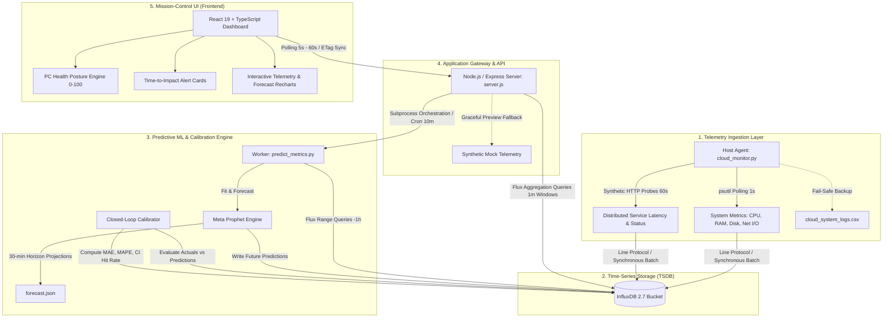

<div align="center">

# ⚡ Ryver: Distributed Telemetry & Predictive System Monitor

**An enterprise-grade, real-time observability pipeline and predictive health engine built for distributed infrastructure and mission-critical systems.**

[](https://www.typescriptlang.org/)
[](https://react.dev/)
[](https://nodejs.org/)
[](https://www.python.org/)
[](https://www.influxdata.com/)
[](https://www.docker.com/)

[Architecture](#-system-architecture) • [Key Features](#-key-features) • [ML & Predictive Pipeline](#-machine-learning--predictive-engine) • [API Reference](#-api-specification) • [Quickstart](#-quickstart--local-development) • [Deployment](#-production-deployment)

</div>

---

## 📌 Executive Overview

Modern distributed environments require continuous, sub-second visibility into hardware utilization, network throughput, and external endpoint health. However, traditional Application Performance Monitoring (APM) tools operate **reactively**—alerting on-call teams only *after* CPU saturation, memory exhaustion, or latency breaches have already occurred.

**Ryver** bridges the gap between reactive alerting and proactive incident mitigation. It pairs low-overhead, high-frequency metrics collection with automated time-series forecasting (Meta Prophet) and an active **closed-loop accuracy calibration engine**. 

Instead of waiting for an out-of-memory crash or sustained CPU throttling, Ryver continuously projects metric trends 30 minutes forward, quantifies statistical confidence intervals ($y_{hat}$, $y_{hat\_lower}$, $y_{hat\_upper}$), computes time-to-threshold impact, and dynamically calibrates its operational recommendations against empirical model accuracy.

---

## 🏛 System Architecture

Ryver uses a decoupled, event-driven architecture designed for high write throughput, non-blocking asynchronous processing, and fault-tolerant failovers.



---

## 🚀 Key Features

### 1. High-Throughput Distributed Telemetry Ingestion
- **Host Hardware Telemetry**: Low-overhead polling of CPU percent (1s sampling interval), physical memory allocation, root disk utilization, and network I/O delta counters (bytes sent/received) via `psutil`.
- **Synthetic Endpoint Probing**: Continuous health checks and millisecond-accurate round-trip response time (RTT) tracking against distributed cloud microservices.
- **Nanosecond-Precision Ingestion**: Structured batch writes to InfluxDB with tagged metadata (`host`, `url`) for indexed query performance.
- **Persistent Local Audit Logging**: Redundant, zero-dependency streaming CSV logger (`cloud_system_logs.csv`) providing audit trails even during database partitions.

### 2. Time-Series Storage & Flux Query Optimization
- **Time-Series Database**: Containerized InfluxDB 2.7 configured for high ingest rates, data compaction, and configurable retention policies.
- **Windowed Aggregations**: Downsamples raw telemetry down to 1-minute mean aggregates via Flux (`aggregateWindow(every: 1m, fn: mean, createEmpty: false)`), minimizing network overhead between TSDB and client.
- **Time-Aligned Pivot Queries**: Dynamic multi-field reshaping for instantaneous comparison of correlated signals (e.g., CPU vs. memory spikes).

### 3. Automated Time-Series Forecasting
- **Additive Decomposition**: Uses Meta's Prophet algorithm to decompose metrics into non-linear trends with seasonal changepoint detection.
- **Confidence Bounds**: Computes expected values ($y_{hat}$) alongside 80% upper and lower statistical bounds ($y_{hat\_upper}$, $y_{hat\_lower}$) across a rolling 30-minute horizon.
- **Non-Blocking Execution**: Background analytical jobs orchestrated via Node.js `child_process.spawn` and automated cron schedules (`node-cron`), preventing gateway event-loop starvation.

### 4. Closed-Loop Accuracy Tracking & Dynamic Confidence
- **Forecast Verification**: Every prediction cycle actively compares elapsed predictions against ground truth measurements recorded in InfluxDB.
- **Model Performance Metrics**: Computes **Mean Absolute Error (MAE)**, **Mean Absolute Percentage Error (MAPE)**, and **Confidence Interval Hit Rate (%)**.
- **Dynamic Language Modulation**: Alert messages dynamically adapt their certainty based on empirical accuracy—shifting from conservative ("may reach") to definitive ("is projected to reach") as model confidence increases.

### 5. High-Density Observability Dashboard
- **PC Health Scoring**: Weighted multi-factor algorithm calculating a unified health score ($0 - 100$) reflecting real-time system stability.
- **Actionable Threshold Forecasting**: Evaluates trajectory slopes to predict the exact time-to-impact (e.g., `CPU is trending upward and will reach 75% in ~12 min`).
- **Bloomberg-Terminal Aesthetic**: Dark-mode glassmorphic interface built with React 19, TypeScript, TailwindCSS, and Recharts, offering sub-second responsiveness and live data indicators.
- **Zero-Downtime Graceful Degradation**: Built-in synthetic telemetry generator automatically activates when the TSDB is disconnected or cold-starting, guaranteeing continuous UI usability.

---

## 🧠 Machine Learning & Predictive Engine

### Model Formulation
System resource utilization (CPU, memory, distributed latency) often exhibits non-stationary behavior, irregular bursts, and gradual memory leak degradation. Ryver models each metric as an additive time series:

$$y(t) = g(t) + s(t) + h(t) + \epsilon_t$$

Where:
- $g(t)$ represents the piecewise-linear or flat trend model detecting long-term load increases.
- $s(t)$ represents periodic cyclic changes.
- $h(t)$ accounts for anomaly windows.
- $\epsilon_t$ is normally distributed error with variance modeling uncertainty intervals.

### Model Calibration & Closed-Loop Validation
Predictions are written to the `forecast_predictions` measurement in InfluxDB. As time passes, `compare_predictions_with_actuals()` queries actual observations and writes validation records to `forecast_accuracy`:

| Metric | Field | Description |
| :--- | :--- | :--- |
| `absolute_error` | Float | $\|y_{actual} - y_{predicted}\|$ |
| `percentage_error` | Float | $\frac{\|y_{actual} - y_{predicted}\|}{y_{actual}} \times 100$ |
| `within_confidence_interval` | Boolean | $y_{hat\_lower} \le y_{actual} \le y_{hat\_upper}$ |

The API gateway surfaces aggregate statistics across a 24-hour window via `/api/forecast-accuracy`, allowing operators to audit model reliability at any time.

---

## 🔌 API Specification

The Node.js gateway provides clean, RESTful JSON endpoints:

### `GET /health`
Returns system status, active data source (live vs. mock), and prediction pipeline state.
```json
{
  "status": "ok",
  "service": "ryver",
  "environment": "production",
  "influxdb": "connected",
  "dataSource": "real",
  "prediction": {
    "lastGeneratedAt": "2026-10-18T11:15:00.000Z",
    "lastError": null,
    "isGenerating": false,
    "status": "success"
  }
}
```

### `GET /api/metrics/live`
Fetches the latest real-time telemetry snapshot (sub-second resolution).
```json
{
  "timestamp": "2026-10-18T11:16:30.124Z",
  "cpu": 24.50,
  "memory": 63.80,
  "web_status": 200,
  "response_time_ms": 118.42,
  "isSimulated": false
}
```

### `GET /api/metrics/history`
Returns 1-hour historical telemetry aggregated into 1-minute windowed means.
```json
[
  {
    "time": "2026-10-18T10:16:00.000Z",
    "cpu": 21.30,
    "memory": 62.10,
    "response_time_ms": 124.50
  }
]
```

### `GET /api/metrics/forecast`
Returns 30-minute forward predictions with upper and lower confidence intervals.
```json
{
  "timestamp": "2026-10-18T11:15:00.000Z",
  "cpu": [
    {
      "ds": "2026-10-18T11:15:05",
      "yhat": 25.10,
      "yhat_lower": 18.40,
      "yhat_upper": 31.80
    }
  ],
  "memory": [ ... ],
  "web": [ ... ],
  "isSimulated": false,
  "forecastAge": 90
}
```

### `GET /api/forecast-accuracy`
Retrieves rolling validation metrics evaluating model accuracy against ground truth.
```json
{
  "status": "available",
  "summary": {
    "totalComparisons": 142,
    "overallMAE": 3.42,
    "overallWithinCI": 128,
    "overallWithinCIPercent": 90.14
  },
  "metrics": {
    "cpu_usage": {
      "comparisonCount": 60,
      "meanAbsoluteError": 4.12,
      "meanPercentageError": 12.8,
      "withinConfidenceIntervalPercent": 88.33
    }
  }
}
```

---

## 🛠 Tech Stack

| Domain | Technology | Purpose |
| :--- | :--- | :--- |
| **Agent / Telemetry** | Python 3, `psutil`, `requests` | Host hardware polling and synthetic external endpoint probe |
| **Predictive Analytics** | Meta Prophet, Pandas, NumPy | Additive time-series regression and confidence interval calculation |
| **Time-Series Storage** | InfluxDB 2.7 (Flux Query Engine) | Nanosecond time-series storage, downsampling, and retention management |
| **Gateway / Orchestration** | Node.js, Express, `node-cron` | Non-blocking API routing, cron scheduling, subprocess execution |
| **Frontend UI** | React 19, TypeScript, TailwindCSS | High-density mission-control dashboard with responsive layouts |
| **Data Visualization** | Recharts, Tabler Icons | Interactive time-series area charts, forecast confidence bands |
| **Containerization** | Docker, Docker Compose | Reproducible local TSDB environment setup |

---

## 📦 Directory Structure

```text
├── .env.example             # Template for required environment variables
├── docker-compose.yml       # InfluxDB 2.7 multi-container orchestration
├── package.json             # Node.js gateway dependencies and build scripts
├── requirements.txt         # Python analytics & telemetry dependencies
│
├── cloud_monitor.py         # Telemetry sentinel agent (host stats + HTTP probe)
├── predict_metrics.py       # ML analytical worker & closed-loop accuracy evaluator
├── server.js                # Express API gateway, Flux client, & cron scheduler
│
├── frontend/                # React 19 + TypeScript application
│   ├── package.json         # UI dependencies (Recharts, Tabler Icons, Tailwind)
│   ├── tsconfig.json        # Strict TypeScript compiler configuration
│   └── src/
│       ├── App.tsx          # Main dashboard, health scoring, and alert cards
│       ├── index.css        # Custom design tokens, glassmorphism, & scrollbars
│       └── ErrorBoundary.tsx # Production runtime error boundary
│
└── RENDER_DEPLOYMENT_GUIDE.md # Production deployment runbook for cloud hosts
```

---

## 💻 Quickstart & Local Development

### Prerequisites
- [Docker & Docker Compose](https://www.docker.com/)
- [Node.js 18+](https://nodejs.org/)
- [Python 3.10+](https://www.python.org/)

### 1. Clone Repository & Configure Environment
```bash
git clone https://github.com/Pomiyilma/Ryver.git
cd Ryver

cp .env.example .env
```

Edit `.env` with your parameters (defaults for local Docker setup):
```env
INFLUXDB_URL=http://localhost:8086
INFLUXDB_TOKEN=my-super-secret-auth-token
INFLUXDB_ORG=my-org
INFLUXDB_BUCKET=system_metrics
RENDER_APP_URL=https://your-service.onrender.com  # Optional: remote endpoint to probe
PORT=3001
```

### 2. Launch InfluxDB via Docker
```bash
docker compose up -d
```
Access the InfluxDB UI at `http://localhost:8086` to verify bucket initialization.

### 3. Install Dependencies
```bash
# Install Python telemetry and ML packages
pip install -r requirements.txt

# Install Node.js gateway dependencies
npm install

# Install Frontend dependencies
cd frontend && npm install && cd ..
```

### 4. Start Services
Open separate terminals (or run as background processes):

```bash
# Terminal 1: Start Ingestion Sentinel Agent
python cloud_monitor.py

# Terminal 2: Run Initial Forecast Pipeline (optional, server triggers this automatically)
python predict_metrics.py

# Terminal 3: Start Node.js API Gateway
npm start

# Terminal 4: Start React Development Server
cd frontend && npm start
```

Open `http://localhost:3000` to access the live dashboard.

---

## 🌐 Production Deployment

### Full-Stack Monolith (e.g., Render Web Service)
Ryver's gateway serves the optimized production React build directly alongside `/api/*` endpoints for simple single-host deployment:

1. **Build Step**:
   ```bash
   npm install && npm run build
   ```
2. **Start Command**:
   ```bash
   node server.js
   ```
3. **Environment Variables**: Configure `INFLUXDB_URL`, `INFLUXDB_TOKEN`, `INFLUXDB_ORG`, `INFLUXDB_BUCKET`, and `NODE_ENV=production`.

For detailed cloud configuration instructions, consult [RENDER_DEPLOYMENT_GUIDE.md](file:///c:/Dev/Project-101/RENDER_DEPLOYMENT_GUIDE.md).

---

## 🛡 Reliability & Fault Tolerance

- **Subprocess Guardrails**: Python forecasting executions are wrapped with isolated stdio buffers and error traps. If the ML pipeline encounters transient data insufficiency, the API gateway logs diagnostics without interrupting request serving.
- **Fail-Safe Synthetic Fallback**: If the InfluxDB connection drops, the gateway transparently switches to deterministic synthetic telemetry, ensuring uninterrupted UI rendering.
- **Circuit-Protected UI**: React components are wrapped with custom error boundaries, preventing single-chart failures from crashing the mission-control dashboard.

---

## 📄 License

This project is licensed under the MIT License — see the LICENSE file for details.
